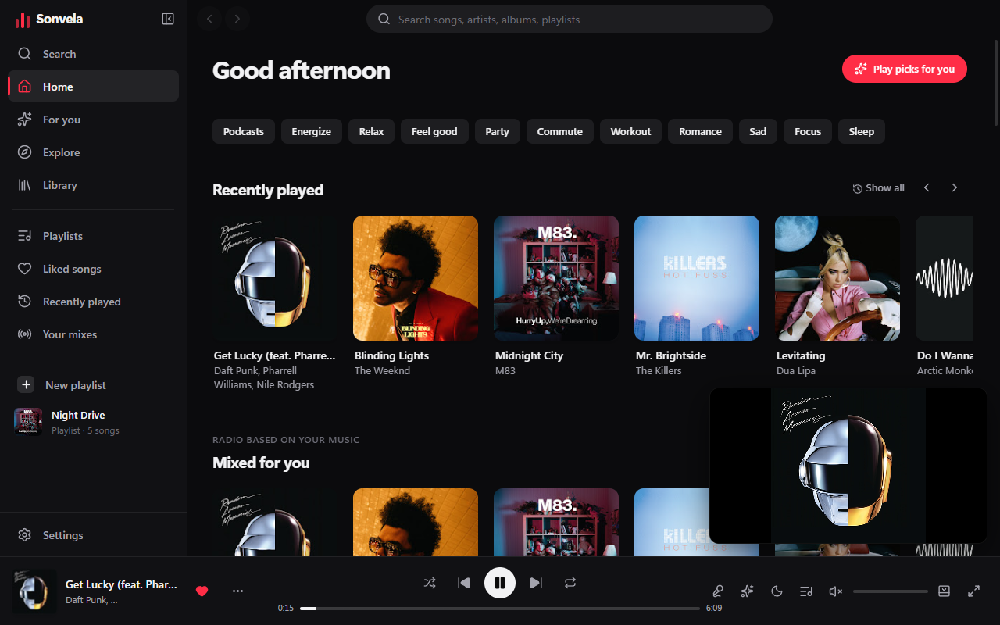
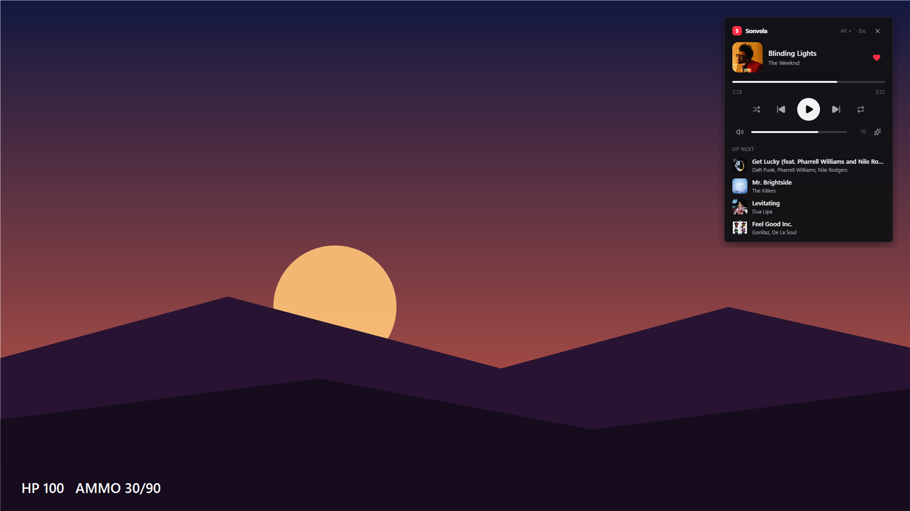
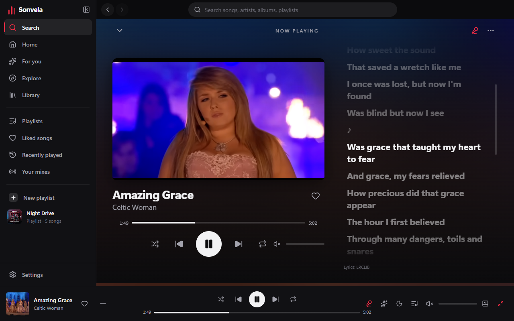
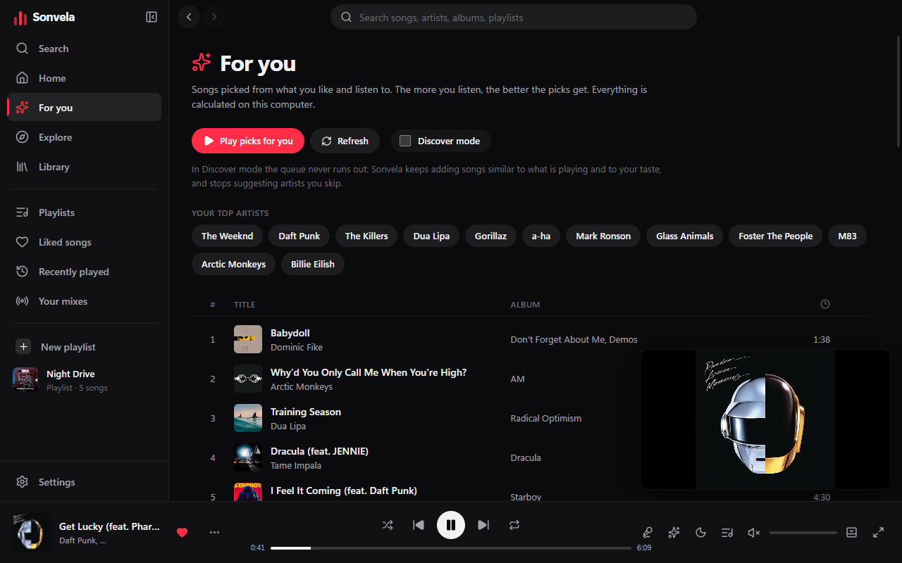

# Sonvela

**A fast, good-looking YouTube Music player for Windows — with an in-game overlay.**

[**⬇ Download for Windows**](https://github.com/Lean302302/sonvela/releases/latest) · [Українською](README.uk.md)

## Why Sonvela

- **In-game overlay.** Press <kbd>Alt</kbd> + <kbd>`</kbd> in a game and a small player appears on top: skip, pause, change the volume, pick the next song — without alt-tabbing. Nothing is injected into the game, so it is safe with anti-cheat.
- **Music picked for you.** Sonvela learns what you like from your history and likes, and *Discover mode* keeps the queue going with similar songs. Artists you keep skipping stop coming back. All of it is calculated on your computer.
- **Synced lyrics.** The current line lights up as the song plays; click a line to jump to it.
- **Ambient light.** A soft glow around the music video follows the colors of the scene. You can turn it off in Settings.
- **Discord status.** Show “Listening to …” with the cover on your Discord profile.
- **Bring your playlists.** Import from Spotify (CSV via Exportify), Apple Music / iTunes exports, or a plain text list.
- **Light on resources.** An optimization mode cuts memory use and unloads the interface while the app sits in the tray.
- **Updates itself.** New versions download in the background and install when you close the app.
- **12 languages:** English, Українська, Polski, Deutsch, Español, Français, Português, Italiano, Türkçe, Русский, 日本語, 中文.

## Screenshots

| In-game overlay | Synced lyrics |
|---|---|
|  |  |

| Picked for you |
|---|
|  |

## Install

1. Download **`Sonvela-Setup-<version>.exe`** from the [latest release](https://github.com/Lean302302/sonvela/releases/latest).
2. Run it. Windows may show *“Windows protected your PC”* because the installer is not code-signed yet — click **More info → Run anyway**.
3. That's it. Sonvela updates itself from now on.

No account is needed to search and play. Signing in with Google is optional and only adds your own YouTube Music playlists and likes (read-only).

## Features

**Player** — search with suggestions, albums, artists, playlists, radio from any song, queue with drag & drop, shuffle and repeat, sleep timer, mini player, compact mode.

**Windows** — media keys, the Windows media flyout, taskbar buttons, tray icon, global shortcuts, start with Windows, notifications.

**Library** — liked songs, your own playlists, history and mixes, stored locally on your PC.

**Privacy** — your library stays on your computer ([privacy policy](PRIVACY.md)). Sonvela never sees your Google password: sign-in happens in your browser, and only a read-only token is kept, encrypted with Windows DPAPI.

### Keyboard shortcuts

| Keys | Action |
|---|---|
| <kbd>Alt</kbd> + <kbd>`</kbd> | Open / close the in-game overlay (anywhere) |
| Media keys | Play/pause, next, previous (anywhere) |
| <kbd>Space</kbd> | Play / pause |
| <kbd>Ctrl</kbd> + <kbd>←</kbd> / <kbd>→</kbd> | Previous / next |
| <kbd>Y</kbd> | Lyrics |
| <kbd>Ctrl</kbd> + <kbd>K</kbd> | Search |

All global shortcuts can be changed in **Settings → Keyboard**.

## FAQ

**Is it free?** Yes.

**Does the overlay work in every game?** It works in games running in *windowed* or *borderless* mode (the default in most modern games). It cannot appear over *exclusive fullscreen* — switch the game to borderless if you don't see it.

**Will the overlay get me banned?** It is a normal always-on-top window; it does not inject into or read from the game process.

**Where does the music come from?** From YouTube Music, played through YouTube's official embedded player.

**Found a bug or have an idea?** [Open an issue](https://github.com/Lean302302/sonvela/issues) — feedback is very welcome.

---

Sonvela is not affiliated with YouTube or Google. YouTube Music is a trademark of Google LLC. Screenshots show album artwork and video frames from YouTube Music for illustration.
