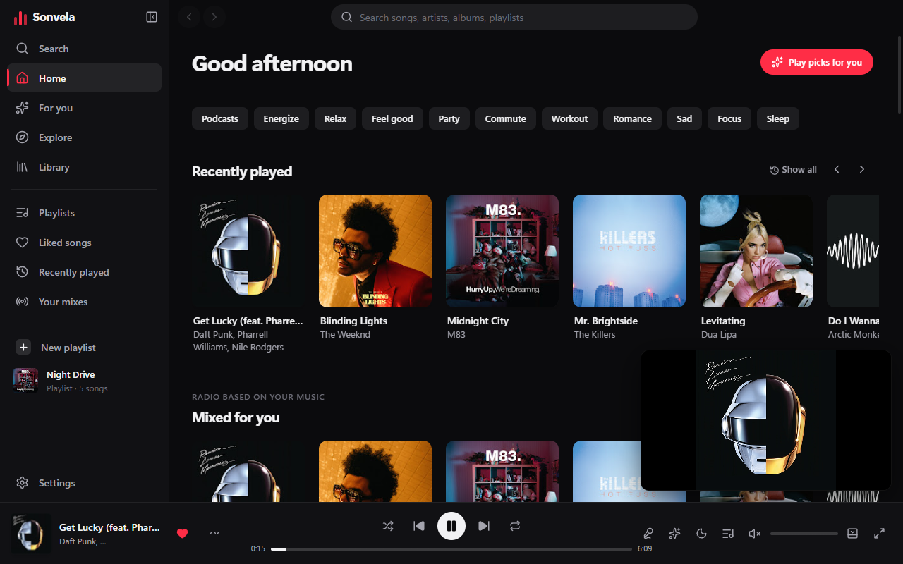
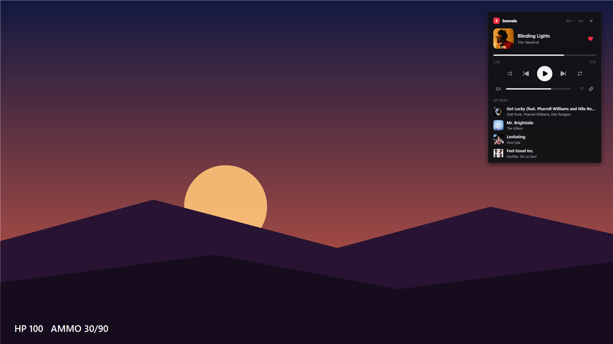
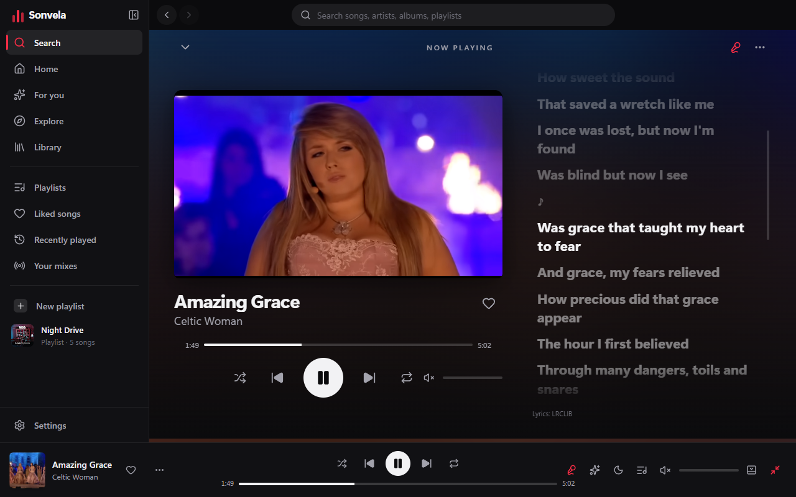
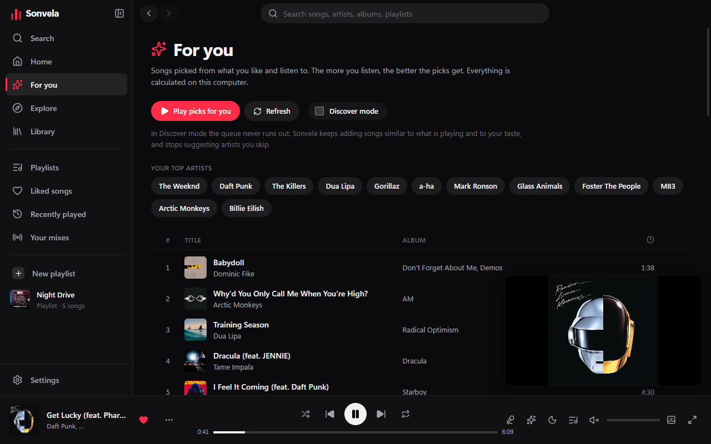

# Sonvela

**Швидкий і гарний плеєр YouTube Music для Windows з ігровим оверлеєм.**

[**⬇ Завантажити для Windows**](https://github.com/skandalbrawl-ship-it/sonvela/releases/latest) · [English](README.md)

## Чому Sonvela

- **Ігровий оверлей.** Натисніть у грі <kbd>Alt</kbd> + <kbd>`</kbd> (клавіша під Esc), і поверх гри з'явиться маленький
  плеєр. У ньому можна перемкнути трек, поставити на паузу, змінити гучність або вибрати наступну пісню, не згортаючи
  гру. У гру нічого не вбудовується, тому з античитами це безпечно.
- **Музика, підібрана для вас.** Sonvela вчиться на вашій історії та вподобаних піснях. *Режим підбору* продовжує чергу
  схожими піснями й перестає пропонувати виконавців, яких ви пропускаєте. Усе обчислюється на вашому комп'ютері.
- **Синхронізовані тексти пісень.** Поточний рядок підсвічується, а клік по рядку перемотує пісню на нього.
- **Статус у Discord.** Профіль показує «Слухає …» з обкладинкою.
- **Ваші плейлисти.** Імпорт зі Spotify (CSV через Exportify), експорту Apple Music / iTunes або текстового списку.
- **Мало ресурсів.** Режим оптимізації зменшує використання пам'яті й вивантажує інтерфейс, коли програма згорнута
  в трей.
- **Оновлюється сама.** Нові версії завантажуються у фоні й встановлюються, коли ви закриваєте програму.
- **12 мов:** українська, English, Polski, Deutsch, Español, Français, Português, Italiano, Türkçe, Русский, 日本語, 中文.

## Скріншоти

| Ігровий оверлей | Синхронізований текст |
|---|---|
|  |  |

| Підбір для вас |
|---|
|  |

## Встановлення

1. Завантажте **`Sonvela-Setup-<версія>.exe`** з [останнього релізу](https://github.com/skandalbrawl-ship-it/sonvela/releases/latest).
2. Запустіть його. Windows може показати «Windows захистила ваш ПК», бо інсталятор поки не має цифрового підпису.
   Натисніть **Докладніше → Усе одно запустити**.
3. Готово. Далі Sonvela оновлюється сама.

Для пошуку й прослуховування акаунт не потрібен. Вхід через Google необов'язковий: він лише додає ваші плейлисти
та вподобане з YouTube Music, і тільки для читання.

## Гарячі клавіші

| Клавіші | Дія |
|---|---|
| <kbd>Alt</kbd> + <kbd>`</kbd> | Відкрити / закрити ігровий оверлей (будь-де) |
| Медіаклавіші | Пауза, наступна, попередня (будь-де) |
| <kbd>Пробіл</kbd> | Відтворити / пауза |
| <kbd>Ctrl</kbd> + <kbd>←</kbd> / <kbd>→</kbd> | Попередня / наступна |
| <kbd>Y</kbd> | Текст пісні |
| <kbd>Ctrl</kbd> + <kbd>K</kbd> | Пошук |

Глобальні комбінації можна змінити в **Налаштування → Клавіатура**.

## Питання

**Це безкоштовно?** Так.

**Оверлей працює в усіх іграх?** Він працює в іграх у *віконному* або *безрамковому* (borderless) режимі, а це
стандартний режим більшості сучасних ігор. Поверх *ексклюзивного повноекранного* режиму оверлей не з'явиться.
Якщо ви його не бачите, перемкніть гру в безрамковий режим.

**Чи можуть забанити за оверлей?** Ні. Це звичайне вікно поверх інших, яке нічого не вбудовує в процес гри і нічого
з нього не читає.

**Звідки музика?** З YouTube Music, через офіційний вбудований плеєр YouTube.

**Знайшли баг або маєте ідею?** [Створіть issue](https://github.com/skandalbrawl-ship-it/sonvela/issues).

---

Sonvela не пов'язана з YouTube чи Google. YouTube Music — торговельна марка Google LLC. На скріншотах для
ілюстрації показано обкладинки й кадри з YouTube Music.
